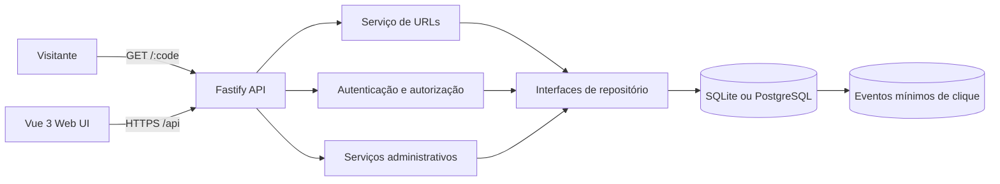
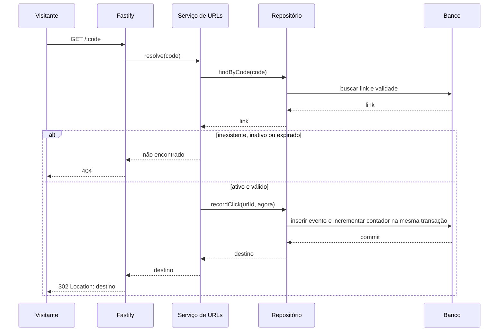

# Arquitetura do encurt.ai

## Objetivo e escopo

Este documento orienta a implementação do encurt.ai, um serviço web para criar URLs curtas, redirecionar visitantes e consultar métricas agregadas de acesso. A arquitetura preserva uma API comum para SQLite e PostgreSQL, separa as regras de negócio dos detalhes de infraestrutura e mantém os dados de cliques livres de identificadores pessoais.

O produto inclui uma API em Node.js e TypeScript, uma interface web em Vue 3 e áreas autenticadas para usuários e administradores. A versão inicial não identifica visitantes únicos nem oferece análise individual de cliques.

## Decisões principais

| Área | Decisão |
|---|---|
| Backend | Node.js LTS, TypeScript strict e Fastify |
| Validação | Zod para ambiente, parâmetros, corpo e consultas |
| Persistência | Drizzle ORM com SQLite por padrão e PostgreSQL opcional |
| Driver | `better-sqlite3` para SQLite e `pg` para PostgreSQL |
| Frontend | Vue 3, JavaScript, Vite, Composition API e Vue Router |
| Autenticação | Sessão opaca server-side em cookie HttpOnly, sem JWT/refresh |
| Métricas | Contador agregado e eventos mínimos com data/hora UTC |
| Identidade de links | Código aleatório criptograficamente seguro, único e case-sensitive |
| Operação | Migrações específicas por dialeto e configuração validada no arranque |

## Visão do sistema



O navegador e visitantes acessam a mesma origem controlada sempre que possível. O frontend chama `/api`; a rota curta `/:code` pertence à API e responde com redirecionamento HTTP. O backend seleciona um adaptador de banco no arranque e expõe as mesmas interfaces de domínio para os dois dialetos.

### Arquitetura-alvo e estado desta entrega

A arquitetura-alvo prevê adaptadores Drizzle SQLite e PostgreSQL, repositórios assíncronos, migrações versionadas independentes por dialeto e contratos de domínio compartilhados. **Esse suporte PostgreSQL não foi entregue nesta etapa.** O estado atual contém somente o adaptador SQLite síncrono com migrações versionadas SQLite (versões 1 e 2), incluindo compatibilidade com o schema existente e migração de `audit_logs` legado. A seleção `DB_CLIENT=postgres` valida `DATABASE_URL`, mas falha explicitamente com erro de adaptador indisponível; não existe fallback para SQLite. Driver `pg`, adaptador PostgreSQL, migrações PostgreSQL e conversão de serviços/handlers para chamadas assíncronas permanecem pendentes.

## Componentes e responsabilidades

### Aplicação HTTP

`src/app.ts` compõe Fastify, registra plugins e rotas e aplica tratamento uniforme de erros. `src/server.ts` carrega a configuração validada, abre a conexão, executa migrações conforme o processo de implantação e encerra conexões em `SIGINT` e `SIGTERM`.

Os plugins cuidam de autenticação por cookie, proteção CSRF, limite de requisições, CORS quando necessário, cabeçalhos de segurança e registro estruturado. Handlers validam entradas, chamam serviços de domínio e traduzem resultados para respostas HTTP; não contêm SQL nem regras de negócio.

### Módulos de domínio

- `modules/urls`: criação, validação de código personalizado, resolução, ativação, expiração e métricas de links.
- `modules/auth`: cadastro, login, renovação e encerramento de sessões, além de leitura do usuário autenticado.
- `modules/admin`: busca e paginação de usuários e links, métricas globais e alterações administrativas auditadas.
- `modules/audit`: gravação dos atos administrativos necessários para explicar mudanças de conta, papel ou link.

Cada módulo separa rotas, schemas, serviços e repositórios. Serviços recebem interfaces de repositório e dependências explícitas; não importam Fastify nem drivers de banco. Os schemas Zod são a fronteira entre dados externos e tipos internos.

### Persistência

**Alvo:** `src/db/index.ts` compõe o cliente Drizzle correspondente a `DB_CLIENT`; `src/db/schema.ts` define os tipos lógicos comuns e o migrador escolhe `migrations/sqlite` ou `migrations/postgres`. Diferenças de SQL ficam nos adaptadores e migrações. **Estado atual:** somente SQLite funcional; `apps/api/src/db/index.ts` aplica versões SQLite 1 e 2, e `DB_CLIENT=postgres` termina com erro explícito.

Os repositórios oferecem operações de domínio, como `create`, `findByCode`, `recordClick`, `setActive`, `getStats` e consultas paginadas administrativas. A escolha do adaptador ocorre uma vez durante a inicialização.

### Interface web

Vue Router separa as rotas públicas, a área do usuário e o painel admin. Composables e serviços de API centralizam sessão, tratamento de erros e chamadas HTTP. Componentes de tela não armazenam tokens bearer. Rotas admin podem ser ocultadas no cliente para navegação, mas cada operação é autorizada novamente pelo servidor.

Os mockups `user-ui.svg` e `admin-ui.svg`, incorporados no `DESIGN.md`, orientam hierarquia visual e estilo. A implementação deve também refletir os estados definidos no domínio: ativo, inativo e expirado.

### Páginas de erro

A aplicação web deve fornecer páginas próprias para **404 Não encontrado**, **403 Acesso negado** e **500 Erro interno**. A página 404 atende rotas de interface inexistentes e links curtos indisponíveis; a página 403 informa que a pessoa autenticada não tem acesso à área ou ação; a página 500 oferece uma mensagem genérica e uma opção segura para voltar ou tentar novamente. As páginas devem seguir o tema da aplicação, funcionar em telas pequenas e oferecer navegação por teclado. Não exibir stack trace, detalhes de banco, código interno, existência de link inativo ou dados privados.

Para navegação de interface, o Vue Router renderiza essas páginas e registra o status HTTP correspondente quando a infraestrutura permitir. Para chamadas de API, responder JSON com status HTTP correto em vez de HTML. Erros devem seguir um formato estável, por exemplo `{ "error": { "code": "FORBIDDEN", "message": "Acesso não permitido", "requestId": "..." } }`; mensagens são seguras para o usuário e `requestId` permite localizar detalhes nos logs. O frontend deve tratar também erros de rede sem presumir que o servidor retornou JSON.

## Modelo de dados

### `users`

Contém `id`, e-mail normalizado e único, hash de senha Argon2id, papel (`user` ou `admin`), datas de criação e atualização, verificação de e-mail opcional e `disabled_at` nullable. Cadastro público sempre atribui `user`; somente operação protegida pode promover um usuário.

### `sessions`

Armazena somente o hash SHA-256 do token opaco aleatório, `user_id`, expiração e revogação. O token em claro existe apenas no cookie do cliente. A sessão tem TTL de sete dias; logout e desativação de conta revogam a sessão no servidor imediatamente. Não há JWT, refresh token ou rotação de tokens nesta versão: sessões opacas tornam revogação e verificação de conta desativada diretas, com menos estado e complexidade no cliente.

### `urls`

Contém `id`, código curto único, destino absoluto HTTP(S), `created_at`, `expires_at` nullable, `is_active`, `click_count` e `user_id`. Novos links exigem dono autenticado; `user_id` pode continuar nullable apenas para compatibilidade com dados legados, se houver.

O estado de apresentação é derivado: **Inativo** quando `is_active=false`; **Expirado** quando há `expires_at <= agora` em UTC; caso contrário, **Ativo**. Inativação manual e expiração são condições separadas. Reativar não altera a data de expiração.

### `click_events`

Contém somente `id`, `url_id` e `occurred_at` em UTC. Índice composto em `(url_id, occurred_at)` suporta séries temporais. Não registrar IP, identificador de visitante, user-agent, query string ou URL de referência. A retenção é configurável; a remoção de eventos antigos não reduz `click_count`, que representa o total agregado histórico.

### `audit_logs`

Registra ator, ação, alvo, horário e metadados estritamente necessários para alterações administrativas. Nunca inclui senhas, cookies, JWTs, tokens de recuperação ou dados individuais de cliques.

## Fluxos centrais

### Criar link

1. O usuário envia URL, código personalizado opcional e expiração opcional.
2. A rota exige sessão válida e valida o payload com Zod.
3. O serviço aceita somente `http:` ou `https:` e não faz requisição de saída para validar o destino.
4. O serviço gera um código aleatório seguro ou valida o código personalizado; colisões retornam `409`.
5. O repositório grava o link com `is_active=true` e `click_count=0`.
6. A API retorna código, URL curta, destino, expiração, estado e contador.

### Redirecionar e registrar clique



O evento e o incremento do contador são atômicos. A operação de registro revalida `is_active`, expiração e estado ativo do dono no banco, dentro da transação, para impedir que uma desativação concorrente registre um novo clique após a pausa ser efetivada. Links inexistentes, inativos, pertencentes a uma conta desativada ou expirados não registram evento. `GET /:code` usa uma resposta `404` para os casos indisponíveis, sem revelar se um código existe. A métrica representa redirecionamentos registrados; não representa usuários únicos nem promete eliminar todos os acessos automatizados.

### Pausar ou reativar link

O dono pode alterar o próprio `is_active`; admin pode alterar qualquer link e a mudança administrativa é auditada. Link inativo não redireciona e não recebe eventos novos, mas seus metadados e métricas históricas seguem visíveis ao dono e admin. Um link expirado permanece expirado após a reativação e continua sem redirecionar.

### Desativar conta

Desativar uma conta define `disabled_at`, revoga suas sessões e marca como inativos todos os links de sua propriedade. A alteração da conta, das sessões e dos links deve ocorrer em uma única transação; a operação administrativa é registrada na auditoria. A conta desativada não pode iniciar sessão, renovar sessão nem usar endpoints autenticados. Ao reativar a conta, os links permanecem inativos até que o dono ou um admin os reative explicitamente. Links que já estavam inativos continuam inativos.

## API e contratos

### Links

| Método e rota | Acesso | Responsabilidade |
|---|---|---|
| `POST /api/urls` | Usuário | Criar link; retorna `code`, `shortUrl`, `targetUrl`, `expiresAt`, `isActive` e `clickCount` |
| `GET /:code` | Público | Registrar clique elegível e responder `302`; casos indisponíveis respondem `404` |
| `GET /api/urls/:code` | Dono ou admin | Retornar metadados, estado, total e série temporal agregada |
| `PATCH /api/urls/:code` | Dono ou admin | Atualizar `{ "isActive": true }` ou `{ "isActive": false }` |
| `GET /api/urls/:code/stats` | Dono ou admin | Consultar contagem agregada em intervalo UTC validado |
| `GET /api/me/urls` | Usuário | Listar links próprios com paginação e filtros |

`GET /api/urls/:code/stats` aceita `from`, `to` e `interval` (inicialmente `day`). Intervalos válidos devem ser limitados para evitar consultas sem limite. Toda busca de link por usuário aplica o filtro de `user_id` no repositório para evitar IDOR.

### Autenticação e administração

Rotas de autenticação: `POST /api/auth/register`, `/login` e `/logout`; perfil: `GET /api/me`. Não existe `/refresh`: o cookie contém a sessão opaca server-side. Rotas sob `/api/admin/*` exigem papel admin consultado no servidor em cada requisição. A API administrativa oferece busca paginada de usuários e links, suspensão e reativação de contas, remoção de links, alteração de papel, estado de links e métricas agregadas. Alterações são auditadas.

Todas as rotas autenticadas retornam erros coerentes para entrada inválida, falta de autenticação, falta de autorização, conflito e recurso indisponível. Os schemas Zod também definem limites de comprimento, campos aceitos e formatos de data; propriedades não reconhecidas não podem mudar papéis ou permissões.

## Segurança e privacidade

- **Validação de entrada:** validar corpo, query string, parâmetros, cabeçalhos relevantes e variáveis de ambiente com schemas Zod; impor limites de comprimento e tipos. Rejeitar campos inesperados em operações sensíveis, especialmente `role`, IDs de dono e propriedades administrativas. Escapar conteúdo exibido em HTML e nunca inserir entrada diretamente em SQL ou comandos.
- **URLs e redirecionamento:** aceitar apenas URLs absolutas `http:` e `https:`; rejeitar esquemas alternativos e entradas malformadas. Não buscar, resolver ou fazer requisição de validação ao destino no servidor. Construir o destino somente a partir do valor armazenado e nunca aceitar destino arbitrário no endpoint `GET /:code`.
- **Autenticação e sessão:** usar senhas Argon2id com parâmetros revisados para o ambiente; limitar tentativas e evitar diferenças de resposta que revelem se um e-mail está cadastrado. O cookie de sessão opaco usa `Secure` em produção, `HttpOnly`, `SameSite=Lax`, `Path=/` e expira em sete dias. Persistir somente SHA-256 do token; nunca registrar token ou cookie. Logout e desativação de conta revogam sessões. A implementação valida `Origin` nas mutações quando o cabeçalho existe e rejeita origem cruzada; `Origin` ausente é aceito hoje. Exigir origem confiável nas mutações de navegador autenticadas por cookie é uma pendência CSRF antes da produção; não há token CSRF separado.
- **Autorização:** negar por padrão e conferir autenticação, papel e propriedade no servidor em cada rota protegida. Aplicar `user_id` na própria consulta do repositório para impedir IDOR. Admin nunca é concedido a partir do payload público. Alterações de papel, conta e link por admin geram trilha de auditoria.
- **Abuso e disponibilidade:** aplicar rate limit com limites separados para login, cadastro, criação de links e redirecionamentos; limitar paginação, tamanho de payload e intervalos de estatísticas. Erros de banco e serviços devem falhar fechados, sem liberar operações parcialmente autorizadas.
- **Banco e transações:** usar Drizzle/consultas parametrizadas e manter a conta de banco com privilégio mínimo. Gravar evento e contador de clique na mesma transação. Restringir acesso ao arquivo SQLite e proteger backups com as mesmas regras de acesso dos dados de produção.
- **Segredos e configuração:** manter credenciais e URLs privadas fora do repositório; fornecer via secret manager ou ambiente protegido. Validar configuração no arranque, falhar com mensagem sem revelar o valor secreto e nunca habilitar segredos de desenvolvimento em produção.
- **Transporte e navegador:** exigir HTTPS em produção. Configurar CSP restritiva, `X-Content-Type-Options`, política de `frame-ancestors`/anti-clickjacking, `Referrer-Policy` e permissões de navegador mínimas. Restringir CORS a origens explícitas; não combinar credenciais com `Access-Control-Allow-Origin: *`.
- **Logs e privacidade:** não registrar senhas, tokens, cookies, cabeçalhos de autorização, query strings completas nem credenciais embutidas em URLs. Usar `requestId` para correlação e redigir dados sensíveis. Métricas de clique não incluem IP, user-agent, identificador de visitante ou referer; aplicar retenção configurada aos eventos.
- **Erros:** retornar mensagens públicas genéricas e códigos estáveis; guardar detalhes técnicos apenas em logs protegidos, com `requestId`. Nunca enviar stack trace, consulta SQL, caminho local ou segredo ao browser. Respostas para códigos curtos indisponíveis permanecem indistinguíveis para não revelar links inativos ou expirados.
- **Dependências e operação:** manter dependências atualizadas, revisar alertas de segurança e fixar versões no lockfile. Executar migrações com acesso controlado, monitorar erros e indisponibilidade, manter backups e validar o processo de restauração antes da produção.
- **Dados de clique:** expor apenas agregações e proteger métricas pelo mesmo controle de proprietário/admin aplicado aos links. A retenção de eventos não altera o total histórico agregado e não deve permitir inferir dados pessoais do visitante.

## Configuração e implantação

Variáveis principais: `PORT`, `BASE_URL`, `DB_CLIENT`, `SQLITE_FILE`, `DATABASE_URL` e `DEFAULT_TTL_DAYS`. `DB_CLIENT` aceita `sqlite` (padrão) ou `postgres`; Postgres exige uma `DATABASE_URL` válida com protocolo `postgres:` ou `postgresql:`. Configuração inválida deve falhar no arranque sem imprimir credenciais. `DEFAULT_TTL_DAYS=0` representa ausência de expiração padrão.

SQLite atende desenvolvimento e instalações pequenas com arquivo persistente e backup. PostgreSQL atende implantação com várias instâncias e concorrência maior. Cada implantação executa o conjunto de migrações correto antes de receber tráfego. O endpoint `/health` verifica HTTP e banco; logs estruturados registram falhas e operações de sistema sem dados secretos ou query strings completas.

## Organização inicial do código

```text
src/
  app.ts
  server.ts
  config/env.ts
  db/
    index.ts
    schema.ts
    migrate.ts
  modules/
    auth/
    urls/
    admin/
    audit/
  plugins/
    auth.ts
    csrf.ts
    error-handler.ts
    rate-limit.ts
  web/                     # aplicação Vue, se servida no mesmo repositório
migrations/
  sqlite/
  postgres/
```

O frontend pode ficar em `web/` ou em pacote separado; a escolha deve preservar a mesma origem pública ou uma configuração explícita de CORS e cookies. Essa organização não obriga que toda lógica de UI seja incluída no processo Fastify.

## Sequência de implementação

1. Criar configuração validada, aplicação Fastify, logger e tratamento uniforme de erros.
2. Implementar schema comum, migrações para os dois dialetos e composição dos adaptadores de banco.
3. Implementar autenticação, sessões rotativas, cadastro seguro e bootstrap operacional do primeiro admin.
4. Implementar criação, redirecionamento, estado ativo/inativo, expiração, clique transacional e métricas.
5. Implementar endpoints administrativos, paginação e trilha de auditoria.
6. Construir a interface Vue para cadastro/login, dashboard do usuário e painel admin segundo os mockups e estados de produto.
7. Documentar execução local, migrações, backups, configuração PostgreSQL e operação de produção.

## Pontos a decidir antes da produção

- Prazo padrão e configuração operacional da retenção de `click_events`.
- Política de verificação de e-mail e recuperação de senha, caso essas funções entrem no escopo do lançamento.
- Origem e mecanismo operacional para provisionar o primeiro administrador.
- Limites de requisição e limites de consulta adequados à infraestrutura de implantação.
